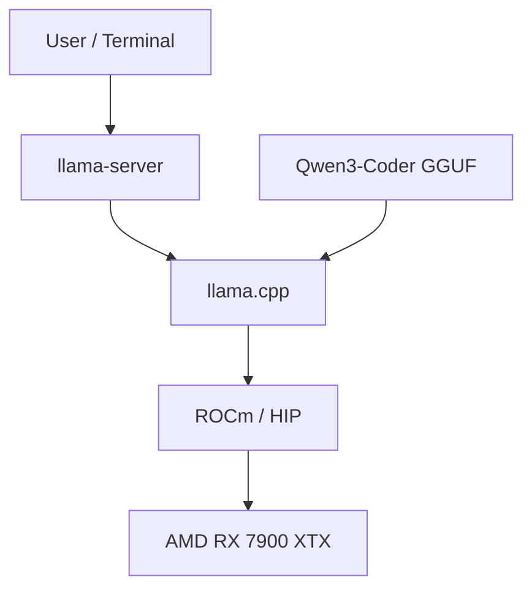

## Building a Local AI Workstation

AI is quickly evolving and becoming a common tool used by millions of people across the world. One tremendous capability of AI is to provide programming assistance to developers. With AI, I have found that I am able to focus more on the architecture of the programs I write rather than focusing on the specific syntax. This can drastically increase the speed at which I develop code, especially in unfamiliar languages. As someone who already owned a relatively powerful home computer, I became interested in seeing what sort of LLM systems I could run locally at home and how they might be useful for my projects. I will be writing a series of articles going through my setup, my software architecture, usage, and the capabilities of this local AI system I set up.

## Why Build a Local AI Workstation?

I chose to build a local AI workstation because I am interested in learning more about how AI works, how I can creatively use it, and how it can enhance my workflows. A subscription to a cloud AI provider such as ChatGPT by OpenAI or Claude by Anthropic would certainly be much more powerful than what is possible to run at home. But running AI at home does have several advantages.

**Data Privacy and Security**: You have full control over your data. No data is sent to commercial AI providers, and any web interactions the AI does are only if permitted by your setup and harness. 

**Cost Efficiency**: Cloud AI can be fairly expensive depending on how much use you make of it. Once you set up the hardware for your local AI, you never have to pay per-token provider costs.

**Fine-Tuning**: You can fine-tune your model on whatever data you want to adapt its behavior more to your specific needs.

**It's Fun!**: Creating a local AI workstation is a fun project, and you'll learn a lot about AI.

## Essential Hardware Components

Currently, we have small toy AI models that can run on even the weakest computers. We have models like TinyLlama that can run on PCs with as little as 2 GB of RAM, while larger models might be exceptionally computationally expensive and demand hundreds of gigabytes of VRAM or RAM.

Generally, we can run models in two main ways. We can load the entire model into RAM and run the computations on the CPU. The hardware to do this is cheaper, but this approach is much slower than the alternative. The alternative is that we have a PC with enough VRAM that we can load the entire model into VRAM. The hardware to do this is much more expensive, but this approach is also much more performant. A third possibility I may explore in future articles is offloading some of the model to RAM and the CPU, while having some or most of the model run on the VRAM and GPU. This hybrid approach may allow us to run much larger models at reduced but acceptable speeds.

At-home AI models can be run on nearly any piece of computing hardware. If you have older or weaker hardware than what I have, I would not let that discourage you; there are still some models you can run, and you can definitely learn a lot about LLMs and AI by doing so.

My personal hardware setup is as follows:

- **CPU**: AMD 7800X3D

- **GPU**: AMD Radeon 7900 XTX with 24 GB of VRAM

- **RAM**: 64 GB of DDR5 RAM

- **Storage**: 3 TB of high-speed NVMe storage

The most important aspect of my setup is the GPU with 24 GB of VRAM. NVIDIA is a common choice for at-home AI setups as NVIDIA supports CUDA, a high-performance parallel computing platform often used for AI acceleration. However, Radeon cards have recently been getting much more mature software support for running local AIs, and my build already had a 7900 XTX with 24 GB of VRAM, so it was a natural choice for me.

If you're building an at-home AI lab, try to get a GPU with lots of VRAM and CUDA or ROCm capability. Common choices include:

- **AMD Radeon 7900 XTX (24 GB of VRAM)**

- **NVIDIA RTX 3060 (12 GB of VRAM)**

- **NVIDIA RTX 3090 (24 GB of VRAM)**

- **NVIDIA RTX 4090 (24 GB of VRAM)**

- **NVIDIA RTX 5090 (32 GB of VRAM)**

There are many other graphics cards you can purchase that are suitable.

## Large Language Models

Before we dive too deeply into the technical specifics, I'd like to introduce some basics about these AI models we're working with. I won't spend time discussing the basics of classic machine learning. This is a bit beyond the scope of what I wish to discuss here, but is very easy to learn more about. A great source to look at would be Google's Machine Learning Crash Course [[1]](#reference-1). This course covers the very basics of machine learning in an approachable and fun way.

What I would like to discuss is large language models (LLMs). LLMs are a form of advanced deep learning trained on human natural language in order to understand human language and perform other human-level tasks [[2]](#reference-2). Deep learning is a subset of machine learning that uses a neural network with many layers in a large interconnected system of "neurons" [[3]](#reference-3). Neural networks, then, are a large network of "neurons" put together. These neurons are simply each a mathematical function that transforms an input. The input is passed through many of these interconnected neurons to calculate the output [[4]](#reference-4). It is fascinating stuff, especially if you're a fan of linear algebra.

LLMs specifically are generally built with a "transformer" neural network architecture. This architecture was first published in 2017 by Google in their paper Attention is All You Need [[5]](#reference-5).

Then, put together simply, LLMs are machine learning models trained on tremendous amounts of data (GPT-6 Astra was trained on over 10 trillion tokens [[6]](#reference-6)). The model takes an input text and computes a likely output based on the input. At first glance, it seems preposterous that the likely outputs could be anything more than correct-sounding gibberish, and in fact you may remember when early LLMs were merely that. But while hallucinations are still a problem, contemporary LLMs have made great strides in accuracy and reasoning ability.

**Note on tokens:** I mentioned tokens instead of words here. We say that LLMs compute their inputs and outputs as tokens, and not words, because the inputs and outputs could be processed as words, characters, or character sets. See [[7]](#reference-7) for more info.

Specifically, I will be using these AI models to perform inference. Inference [[8]](#reference-8) is when we give a trained AI model new inputs it may have never seen before, and it then produces an output based on this.

## Understanding VRAM Limitations

I've already mentioned how important VRAM is for running local AI. But here I'll go into more detail about the reasons why. AI model performance is limited by VRAM in the following ways.

1. **Model Parameters:** The number of parameters, typically measured in billions, that make up the neural network.

2. **Model Quantization:** The precision we use to represent these parameters. Think of the different levels of precision we typically use when doing computer-based mathematics. Think floating-point math, integer math, etc.

3. **Context Window:** How much information the model can use in memory while considering a query.

4. **Key-Value (KV) Cache:** Cache used to store previously computed values in memory, reducing inference complexity at the expense of memory.

5. **Total VRAM Allocation:** The total amount of VRAM used by your system during all of this can't exceed the VRAM of your GPU. This means the combined memory requirements of all previous concepts plus the VRAM used by your system for processing the GUI can't exceed 24 GB in my case if I want to run the model at the highest speed all in VRAM.

### Model Parameters

Large language models are often referred to by the number of weights or parameters. These parameters are learned during the creation and training of the models. These weights determine how the inference pass processes inputs and generates an appropriate response. Parameters are the internal variables of any machine learning network, while weights are specifically the numerical parameters within a neural network that are used in the mathematical calculations that transform the input to the output [[9]](#reference-9).

Common model sizes include:

| Model Size | Parameters | Relative Size |
|:----------:|-----------:|:--------------|
| **3B**     | 3 billion  | █ |
| **7B**     | 7 billion  | ██ |
| **13B**    | 13 billion | ████ |
| **30B**    | 30 billion | ██████████ |
| **70B**    | 70 billion | ███████████████████████ |

As the model weights increase, we drastically increase the VRAM demand. Models with a higher number of parameters are generally more intelligent and performant. However, with advances in architecture and efficiency, we are seeing current-generation smaller-weight models outperform older large-weight models. However, all else being equal, a model with more parameters will likely outperform a smaller-weight model.

The amount of VRAM used by storing the model weights in memory can be calculated in the following way.

$$
\text{Model Size (Bytes)} =
\text{Number of Parameters}
\times
\text{Bytes per Parameter}
$$

For example, running a 70B parameter model with 16-bit floating-point precision (FP16 requires 2 bytes per number) would yield the following memory requirements.

$$
70 \times 10^9 \times 2 = 140 \times 10^9 \text{ bytes} = 140 \text{ Gigabytes}
$$

This is far beyond the 24 GB of VRAM I have, and even beyond what is possible if we want to offload the model into RAM. However, the good news is that quantization can be used to reduce memory requirements.

It is also important to note here that this is merely what is needed to store the model weights; other aspects of running the model could push our VRAM usage even higher.

### Quantization

Quantization is how we can reduce the memory requirements for running a given model. Generally, during training, a model is trained with very high-precision numbers. For example, the weights could be calculated with 32-bit floating-point accuracy. However, when using a trained model, most of the capability can be retained even when representing the weights with lower precision numbers, while drastically saving on the memory requirements. For that same 70B parameter model we discussed, here is how different quantizations of weights could affect the memory requirements.

#### Theoretical Weight Storage (Excluding Metadata, Buffers, and KV Cache)

| Precision | Bits per Parameter | Approximate Weight Storage |
|:----------|-------------------:|---------------------------:|
| FP32      | 32                 | 280 GB                     |
| FP16/BF16 | 16                 | 140 GB                     |
| INT8      | 8                  | 70 GB                      |
| INT4      | 4                  | 35 GB                      |
| INT3      | 3                  | 26.25 GB                   |
| INT2      | 2                  | 17.5 GB                    |

For my first model, I chose **Qwen3-Coder-30B-A3B-Instruct in the Q4_K_M format**. Q4_K_M is a quantization preset that primarily quantizes the model with 4-bit accuracy. See the documentation [[10]](#reference-10) for more info.

### Key-Value Cache

The key-value cache (KV cache) is the cache that stores key and value tensors from the attention layers. This means the results of previous computations when computing the attention work for a transformer model are stored, rather than rerun. This greatly reduces the computational complexity because, to compute N + 1 tokens, we need to compute all the previous tokens from 0 to N. If we did not store these results in a cache, we would have to recalculate all the previous tokens each time we calculated a new token. However, an obvious downside of this is that the KV cache can greatly increase the memory cost of running the model [[11]](#reference-11). This generally reduces the quadratic cost of attention work per decoding step to a linear cost. It's important to note here that this memory cost can be enough to have a significant impact on the performance of a model. Increasing this context memory could push a model’s memory requirement too high to fit in VRAM. So tuning an appropriately sized context window is important.

### Mixture of Experts

The initial Qwen model I chose is actually a mixture-of-experts (MoE) model. This is an exciting class of model that can perform the inference (thinking) much more quickly than non-MoE models of the same parameter count. Traditional neural networks send every token through the same neural network. However, with an MoE, the model contains multiple specialized neural networks that tokens are intelligently routed through. This allows the model to perform inference more quickly, as we don't have to activate every neural network in the layer for every token; we merely need to activate the selected experts. For example, Qwen3-Coder-30B-A3B has 30 billion parameters, but only activates 3 billion per token. It is important to note that all the model weights still need to be loaded into memory; the MoE merely improves the speed of inference; it does not reduce the memory required. See Hugging Face's article [[12]](#reference-12) regarding MoEs for more info.

## Software Setup

### Operating System

I use Ubuntu for my local AI workstation as Linux currently has much better ROCm support (AMD’s software stack for highly performant computing on GPUs) than Windows. However, Windows support for ROCm has drastically improved lately. If you are willing to go through a slightly more complicated setup, it is now quite suitable for your at-home AMD AI lab. macOS is also a suitable choice for at-home AI if you have a Mac with an M-series processor and enough unified RAM to run the models you are interested in using.

### Key Software Stack

- **Ubuntu Linux [[13]](#reference-13)**: The operating system hosting the AI inference engine and development tools.

- **AMD ROCm/HIP [[14]](#reference-14)**: AMD's GPU compute platform, allowing AI workloads to efficiently make use of the AMD hardware.

- **llama.cpp [[15]](#reference-15)**: The open-source inference engine. I compiled it targeting ROCm and the 7900 XTX that I have.

- **Qwen3-Coder GGUF [[16]](#reference-16)**: The open-weight inference model. It was chosen as it can fit nicely on my 24 GB VRAM GPU and should be able to provide a real boost to my coding productivity.

### Software Architecture

### Next Steps

Finally, with all of the prerequisite software installed, I was ready to set up Qwen3-Coder and start using it—a process I'll detail in my next post.

## References

1. [Google's Machine Learning Crash Course](https://developers.google.com/machine-learning/crash-course)
2. [IBM — Large Language Models](https://www.ibm.com/think/topics/large-language-models)
3. [IBM — Deep Learning](https://www.ibm.com/think/topics/deep-learning)
4. [IBM — Neural Networks](https://www.ibm.com/think/topics/neural-networks)
5. [Attention is All You Need](https://arxiv.org/abs/1706.03762)
6. [OpenAI — Public Summary of Training Content for GPT-6 Astra](https://cdn.openai.com/pdf/gpt-6-astra-eu-ai-act-public-summary-of-training-content.pdf)
7. [Microsoft — Understanding Tokens](https://learn.microsoft.com/en-us/dotnet/ai/conceptual/understanding-tokens)
8. [Google Cloud — AI Inference](https://cloud.google.com/discover/what-is-ai-inference)
9. [Stanford HAI — What Are Parameters?](https://hai.stanford.edu/ai-definitions/what-are-parameters)
10. [llama.cpp — Quantization Documentation](https://github.com/ggml-org/llama.cpp/blob/master/tools/quantize/README.md)
11. [Hugging Face — How Caching Works](https://huggingface.co/docs/transformers/cache_explanation)
12. [Hugging Face — Mixture of Experts Explained](https://huggingface.co/blog/moe#a-brief-history-of-moes)
13. [Ubuntu Linux](https://ubuntu.com/)
14. [AMD ROCm/HIP](https://rocmdocs.amd.com/projects/HIP/en/latest/what_is_hip.html)
15. [llama.cpp](https://github.com/ggml-org/llama.cpp/blob/master/docs/build.md)
16. [Qwen3-Coder GGUF](https://huggingface.co/DevQuasar/Qwen.Qwen3-Coder-30B-A3B-Instruct-GGUF)