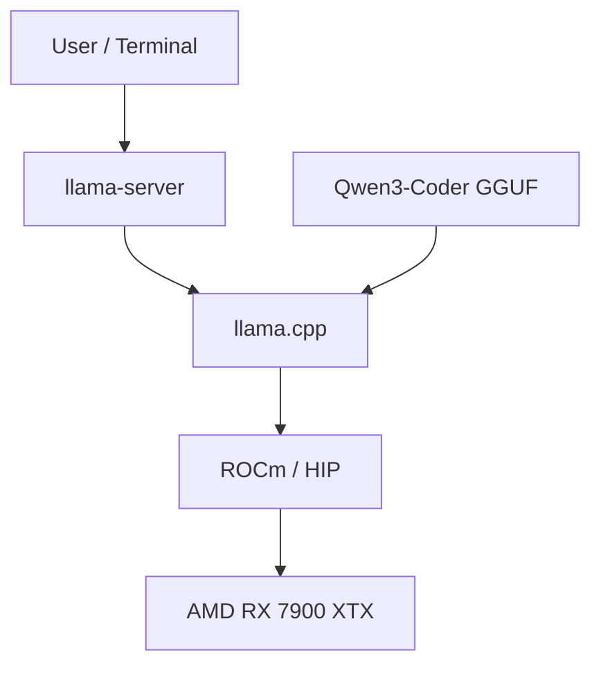

## Building a Local AI Workstation

Ai is quickly evolving and becoming a common tool used by millions of people across the world. It is becoming necessary to become familiar with it to stay up to date on current trends as a dev, and remain a competitive programmer. 

## Why Build a Local AI Workstation?

I chose to build a local AI workstation, because I am interested in learning more about how AI works, how I can creatively use it, and how it can enhance my workflows. A subscription to a cloud AI provider such as Chat GPT by Open AI, or Claude by Anthropic would certainly be much more powerful than what is possible to run at home. But running AI at home does have several advantages. 

**Data Privacy and Security**: You have full control over your data, you never need to worry about sensitive data being stored or leaked by these cloud AI providers. 

**Cost Efficiency**: Cloud AI can be fairly expensive depending on how much use you make of it. Once you set up the hardware for your local AI, you never have to pay usage costs.

**Fine Tuning**: You can fine tune your model on whatever data you want, to ensure it behaves more in line with your specific needs. 

**It's Fun!**: Creating a local AI workstation is a fun project, and you'll learn a lot about AI. 

## Essential Hardware Components

Currently we have small toy AI models that can run on even the weakest computers. We have models like TinyLLama that can run on PCs with as little as 2GB of RAM. While larger models might be exceptionally computataionally expensive and demand hundreds of gigabytes of VRAM or RAM. 

Generally we can run models in one of two ways. We can load the entire model into RAM and run the computations on the CPU. The hardware to do this is cheaper, but this approach is much slower than the alternative. The alternative is that we have a PC with enough VRAM that we can load the entire model into VRAM. The hardware to do this is much more expensive, but this approach is also much more performant. 

While you can use any PC for playing with AI, personally I think 12GB of VRAM is the point where local AI can move from a toy, to something actually useful. 

My personal hardware setup is as follows

- **CPU**: AMD 7800X3d
- **GPU**: AMD Radeon 7900XTX with 24GB of VRAM 
- **RAM**: 64GB of DDR5 RAM
- **Storage**: 3TB of high speed NVME storage

The most important aspect of my setup is the GPU with 24GB of VRAM. Nvidia is a common choice for at home AI setups as Nvidia supports CUDA, a high performance parallel computing platform often used for AI acceleration. However, Nvidia graphics cards are 
currently much more expensive than Radeon graphics cards, and Radeon cards have recently been getting much more mature software support for running local AIs.

If you're building an at home AI lab, just try to get a GPU with as much VRAM as you can possibly afford. Common choices include 

- **AMD Radeon 7900XTX (24GB of VRAM)**
- **Nvidia RTX 3060 (12GB of VRAM)**
- **Nvidia RTX 3090 (24GB of VRAM)**
- **Nvidia RTX 4090 (24GB of VRAM)**
- **Nvidia RTX 5090 (32GB of VRAM)**

##

There are many other graphics cards you can purchase that are suitable. 

## Understanding VRAM Limitations 

I've already mentioned how important VRAM is for running local AI. But here I'll go into more detail about the reasons why. AI model performance is limited by VRAM in the following ways. 

1. **Model Paramaters:** The number of paramaters, typically measured in billions, that make up the nueral network. 
2. **Model Quantitization:** The precision we use to represent these parameters. Think of the different levels of precision we typically use when doing computer based mathematics. Think floating point math, integer math, etc. 
3. **Context Window:** How much information the model can use in memory while considering a query. 
4. **Key-Value (KV) Cache:** Cache used to store previously computed values in memory. Reducing inference complexity from O(n2) to O(n). 
5. **Total VRAM Allocation:** The total amount of  VRAM used by your system during all of this can't exceed the VRAM of your GPU. This means the combined memory requirements of all previous concepts plus the VRAM used by your system for processing the GUI, can't exceed 24GB in my case. 

### Model Parameters 

Large language models are often referred to by the number of weights or parameters. These parameters are learned during the creation and training of the models. These weights determine how the inference pass processes inputs and generates an appropriate response. 

Common weights include 
| Model Size | Parameters | Relative Size |
|:----------:|-----------:|:--------------|
| **3B**     | 3 billion  | █ |
| **7B**     | 7 billion  | ██ |
| **13B**    | 13 billion | ████ |
| **30B**    | 30 billion | ██████████ |
| **70B**    | 70 billion | ███████████████████████ |

As the model weights increase, we drastically increase the VRAM demand. Models with a higher number of parameters are generally more intelligent and performant. However, with advances in architecture and efficiency, we are seeing current generation smaller weight models outperform older large weight models. However, all else being equal a larger weight model will almost certainly outperform a smaller weight model. 

The amount of VRAM used by storing the model weights in memory can be calculated in the following way. 

$$
\text{Model Size (Bytes)} =
\text{Number of Parameters}
\times
\text{Bytes per Parameter}
$$

For example, running a 70B paramater model, with floating point 16 precision (FP16 requires 2 bytes per number) would yield the following memory requirements. 

$$
70 \times 10^9 \times 2 = 140 \times 10^9 \text{ bytes} = 140 \text{ Gigabytes}
$$

## Software Setup

### Operating System
I use Ubuntu for my local AI workstation as Linux currently has much better ROCm (AMD Drivers for highly performant computing on GPUs) than Windows. However Windows support for ROCm has drastically improved lately, if you are willing to go through a slightly more complicated setup it is now quite suitable for your at home AMD AI lab. MAC OS is also a suitable choice for at home AI if you a MAC with an M series processor and enough unified RAM to run the models you are interested in using. 

### Key Software Stack
- **Ubuntu Linux** The operating system hosting the AI inference engine and development tools.
- **AMD ROCm/**HIP**  AMD's GPU compute platform, allowing AI workloads to efficiently make use of the AMD hardware. 
- **llamma.cpp** The open source inference engine. I compiled it targeting ROCm and the 7900XTX that I have. 
- **Qwen3-Coder GGUF** The open weight inference model. It was chosen as it can fit nicely on my 24GB VRAM GPU, and should be able to provide a real boost to my coding productivity. 

### Software Architecture

