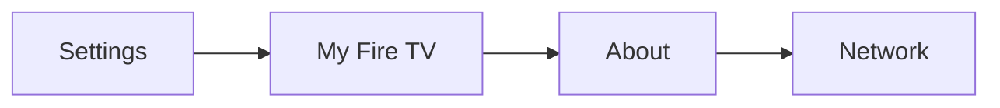
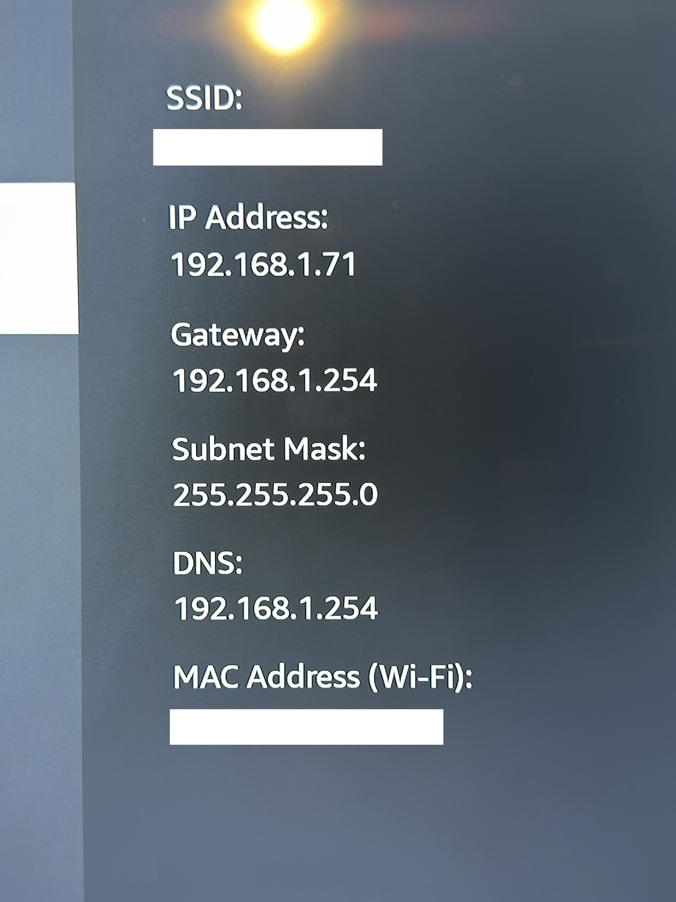
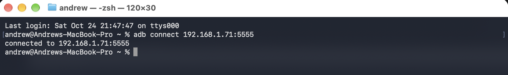
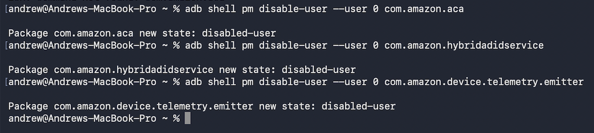

## Project Introduction

At home I have a Fire TV Stick 4K Max (2nd generation). I purchased this a few years ago and use it as my primary method to stream content to my TV. As I have become more privacy conscious, I feel a bit less comfortable with having this device connected to my network. Amazon includes a variety of services that track what I do with my Fire TV, and serve up personalized advertisements. I recently discovered that it is possible to disable many of these background tracking services, and I am going to walk through how I accomplished that.

## Setup

For this project I used my MacBook, however all of the tools I used should be available on both Windows and Linux, so nothing here is device dependent. However, the device version for the Fire TV is important, as it is important that you have an Android-based Fire TV for this to work. Amazon has begun to replace their Android-based Fire TV streaming devices with Vega based devices. Vega is a proprietary Linux-based operating system developed by Amazon. These Vega devices are far more locked down, and difficult to modify. [[1]](#reference-1) [[2]](#reference-2)

1. Enable Developer Mode on the Fire TV
2. Install Android Debug Bridge (ADB)

Both of these steps are well documented [here](https://www.developer.amazon.com/docs/fire-tv/connecting-adb-to-device.html) [[3]](#reference-3). It includes instructions for installing ADB on both Mac and Windows. If you are installing ADB on Ubuntu, you can run the following terminal commands.

```bash
sudo apt update
sudo apt install adb
```

## Connect

Next, we must connect our computer to the Fire TV. Find the TV's IP address





You should see something similar to this screenshot here. Note down the IP address.

Now that we have the IP address, we can connect to the TV using the terminal. Note that the debug tools connect over port 5555.

```bash
adb connect 192.168.1.71:5555
```

If successful you should see something like this.



You may see a popup on the Fire TV asking you to approve debugging. If you see this approve it.

## Backup Configuration

At this point we can begin disabling packages. However, it is best practice to document the current package configuration so we can restore it if we break anything. Using the debug mode, we are very unlikely to be able to do anything that bricks the device, but we could accidentally disable core packages that turn off features we want to use. By documenting all the packages we have installed and enabled right now, we can create a list to refer to, and manually restore if we break anything. 

I ran the following commands in the terminal to document the original configuration. 
```bash
# Device model
adb shell getprop ro.product.model

# Firmware build
adb shell getprop ro.build.version.incremental

# Installed packages
adb shell pm list packages > ~/firetv-packages.txt

# Already-disabled packages
adb shell pm list packages -d > ~/firetv-disabled-before.txt
```

## Disable Packages

Now, we can begin disabling packages. Run the following command in the terminal to disable a chosen package. [[4]](#reference-4)

```bash
adb shell pm disable-user --user 0 com.amazon.tv.acr
```

To help decide which packages to disable, I consulted [this Git Repo](https://github.com/26zl/tv-tweak/tree/main) [[5]](#reference-5) for the tv-tweak project. This project is an automated tool to debloat your Android TV devices. I chose to manually debloat however, rather than install a relatively unknown Git repo. The list of packages to consider removing is [here](https://github.com/26zl/tv-tweak/blob/main/devices/firetv-stick-4k-max-2023/packages.conf) [[6]](#reference-6).

If your commands for disabling the packages work, you should see something like this.




I chose to disable the following packages. 

| Package | Documented function |
|---|---|
| `com.amazon.tv.acr` | Automatic content recognition |
| `com.amazon.aca` | ACR companion and activity monitoring |
| `com.amazon.hybridadidservice` | Advertising ID |
| `com.amazon.device.telemetry.emitter` | Device telemetry |
| `com.amazon.wirelessmetrics.service` | Wireless metrics |
| `com.amazon.perfc` | Performance collection |
| `com.amazon.perfcollection` | Performance monitoring |
| `com.amazon.dp.logger` | Diagnostic logging |

After disabling, I didn't notice any impact on the Fire Stick's performance. But it is nice knowing that I have disabled some of the tracking and telemetry services. 

## Conclusion

After you disable what you wish to, you can restart your Fire TV, and check which packages are disabled. Confirm the ones you disabled are actually disabled.

```bash
adb shell pm list packages -d
```

When we're done, we should turn ADB debugging back off, as it poses a minor security concern to leave enabled.

This was a relatively simple way to disable some of the advertising and tracking related packages on the device. In the future, I plan to create a custom Fire TV launcher, that will fully customize the home screen, and remove even more advertisements.


## References

1. <span id="reference-1"></span>[Amazon Developer — Fire OS Overview](https://developer.amazon.com/docs/fire-tv/fire-os-overview.html)
2. <span id="reference-2"></span>[Amazon Developer — Getting Started with Vega OS Development](https://developer.amazon.com/apps-and-games/blogs/2026/07/guide-to-building-for-fire-tv-on-vega-os)
3. <span id="reference-3"></span>[Amazon Developer — Connecting to Fire TV Through ADB](https://developer.amazon.com/docs/fire-tv/connecting-adb-to-device.html)
4. <span id="reference-4"></span>[Google Android Developers — Android Debug Bridge](https://developer.android.com/tools/adb)
5. <span id="reference-5"></span>[26zl — TV Tweak GitHub Repository](https://github.com/26zl/tv-tweak)
6. <span id="reference-6"></span>[26zl — Fire TV Stick 4K Max (2023) Package Configuration](https://github.com/26zl/tv-tweak/blob/main/devices/firetv-stick-4k-max-2023/packages.conf)
